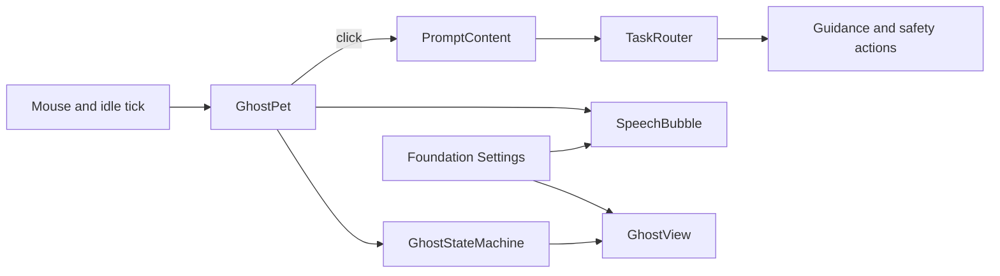

# Design: Ghost pet

## Overview

The pet feature uses two panels above foundation overlays: one for the ghost and one for speech or
input. A pure reducer owns semantic state, while panel movement and animation remain adapters around
that state.



## Panels and hit testing

`GhostPanel` is a 220×220 nonactivating `NSPanel`. Construction sets `isFloatingPanel` before setting
its level to screen saver + 1. It cannot become key. It joins Spaces, remains stationary, supports
full-screen auxiliary use, and stays out of window cycling.

`BubblePanel` is at screen saver + 2. Passive bubbles cannot become key and ignore mouse events unless
they contain actions. Prompt bubbles use `.nonactivatingPanel`, can become key, and call
`makeKeyAndOrderFront` so their field receives typing without changing app activation policy.
`SpeechBubble` stores the previously active app and reactivates it after submit/cancel if still
running.

Ghost hit testing uses the procedural body path, expanded only enough to make narrow visual edges
usable. A parked tick changes `ignoresMouseEvents` only when the pointer crosses that path. During a
drag, the panel continues receiving the matching mouse-up. Bubble actions use their own window hit
area; all other pixels remain click-through.

## GhostPet movement and lifecycle

`GhostPet.Mode` is:

```text
hidden | parked | anchored(globalPoint, generation) | dragging(pointerOffset)
```

There is no follow mode. `anchored` exists only for the explicit rise/sink transition and uses a
short spring or a fade under Reduce Motion. Arrival always becomes `parked`.

On mouse-down, `GhostPet` records the global pointer and panel offset. It classifies movement by
Euclidean distance from that initial point. A sub-4 pt mouse-up opens the prompt; a drag follows the
pointer with the stored offset while constraining the complete body to the union of visible frames.
Release computes the complete body rectangle, chooses the containing or nearest visible screen,
clamps for numerical edge cases, parks, and persists:

- global body anchor;
- a stable display identifier when available;
- normalized location in that display’s visible frame.

Restore prefers the saved display and normalized location, then validates/clamps. If that display is
missing, it chooses the nearest current visible frame to the saved global point. Display-change
callbacks repeat this reachability check without moving a ghost that is already fully visible.

The idle tick runs slowly while parked and temporarily at 60 Hz only for drag or active pet animation.
It tracks last pointer movement/semantic event, sleep threshold by local time, hover enter/exit, body
hit state, and bubble attachment. Injected clock/random providers make blink, yawn, and sleep timing
testable.

## Pure state machine

`GhostStateMachine` stores:

```swift
struct GhostStateMachine {
    var visible: GhostState
    var suspendedByDanger: GhostState?
}
```

`handle(_:)` is a pure mutating reducer or a pure `(machine,event) -> machine` function. Safety rules
run before normal transition lookup. A repeated `dangerDetected` does not overwrite the original
suspended state.

Normal transition table:

| Event | Accepted source states | Destination |
|---|---|---|
| `startListening` | idle, sleeping, success | listening |
| `startPlanning` | idle, listening, sleeping, success | planning |
| `startSearching` | planning, found, waitingForClick, seance, searchingHard | searching |
| `escalateSearch` | searching | searchingHard |
| `targetFound` | searching, searchingHard | found |
| `awaitClick` | found, wrongClick | waitingForClick |
| `clickedWrong` | waitingForClick | wrongClick |
| `wrongClickRecovered` | wrongClick | waitingForClick |
| `cannotFind` | searching, searchingHard | seance |
| `stepDone(last: false)` | waitingForClick, found, seance | searching |
| `stepDone(last: true)` | waitingForClick, found, seance | success |
| `idleTooLong` | idle | sleeping |
| `activity` | sleeping, success | idle |

`cancel` and danger events follow R4.9 instead of this table. Every other source/event pair is an
identity transition. The guidance feature sends events; it never sets a visual state directly.

## GhostView

`GhostBodyView` draws Wailo’s original body, eyes, blush, mouth, glow, puff, and frost paths. It
exposes semantic parameters rather than guide logic. `GhostView` composes the body with
`CauldronView`, one accessory image, and disposable Core Animation effects for wisps, bubbles,
candles, beams, sparkles, and symbols.

Entering a state first removes effects from the prior state, then applies the R4.7 appearance. Each
moving effect has a Reduce Motion variant. `searching` may show a stronger local lantern message
while exhaustive local search continues. `searchingHard` is entered only when foundation consent is
active and a vision request begins; it shows the crystal ball and the explicit “The crystal ball is
looking at this screen” message, then leaves that state when the request completes or is cancelled.

Idle animation uses additive transforms so layout does not alter the parked panel position. A hover
response is edge-triggered, suppressed while any bubble is visible, and reset only after pointer exit.

## SpeechBubble and prompt

`SpeechBubble` measures `NSHostingView.fittingSize` before setting `sizingOptions = []`. It offers:

```text
say(text, style, actions, autoHide, centerOnScreen)
ask(prompt, suggestions, onSubmit, onCancel)
follow(ghostFrame, visibleFrames)
covers(globalPoint)
```

Placement tests above the ghost first and below second, then clamps both axes to the chosen visible
frame. A centered warning belongs to the display selected by its caller.

`PromptContent` uses `@FocusState`, a 19 pt field/label style, 44 pt controls, Return submission, and
`onExitCommand`. Opening emits `startListening`. It guards submission with a local consumed flag so
Return and button handling cannot emit twice; submit or cancel emits `cancel` before dispatching any
selected action. Whitespace-only submission leaves the prompt visible and presents a gentle
validation message.

## TaskRouter

`TaskRouter` is pure and has no AppKit dependency. Normalization uses Unicode case folding, replaces
runs of non-alphanumeric characters with one boundary, and splits into nonempty tokens. Route terms
are complete tokens; this avoids routing `email` merely because it contains the character substring
`mail`. Multiword terms, if later added, compare consecutive normalized tokens.

The router checks R5.2 groups in priority order and returns:

```text
newFolder | safari | cursed | ghostMail | grimoire | live(trimmedOriginal) | nothing
```

The prompt and all suggestions call the same router. A small action adapter maps these values to
feature entry points without adding matching logic.

## Error handling

- If a saved screen identifier no longer exists, restore uses nearest/clamped placement.
- If a previous app exits while the prompt is open, closing the prompt does not attempt activation.
- If bubble content exceeds available space, its content scrolls or wraps within the visible frame.
- If a semantic event is invalid for the current state, the reducer leaves state unchanged.
- A stale rise/sink or auto-hide callback checks its generation before changing mode or UI.

## Verification

Property tests cover the complete state/event product, arbitrary event sequences, danger/cancel
invariants, clamping idempotence, arbitrary Unicode routing, priority, and prompt emission guards.
Manual tests cover body-only hit testing, click-versus-drag, persistence through relaunch/display
removal, all semantic looks, Reduce Motion, keyboard and VoiceOver operation, and bubble placement at
every screen edge.
