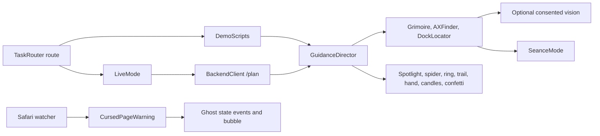

# Design: Guidance and safety

## Overview

`GuidanceDirector` is the single owner of an active guide. Built-in scripts and backend plans both
produce the same `GuideStep` model. Search adapters return AX rectangles; foundation converts those
rectangles and owns overlay selection. The pet receives state events rather than guide internals.



## Guide model

```swift
struct GuideStep {
    let instruction: String
    let query: TargetQuery
    let action: HandAction
    let bundleHint: String?
    let advance: AdvanceRule
}

enum TargetQuery {
    case none
    case dockItem(String)
    case menuBarItem(String)
    case menuItem(String)
    case element(keywords: [String], roles: [String])
    case safariAddressBar
    case smart(String)
}

enum AdvanceRule { case clickInTarget, returnKeyOrNext }
enum HandAction { case tap, doubleTap, drag(to: CGPoint), none }
struct DemoScript { let title: String; let steps: [GuideStep] }
```

Instruction-only steps use `.none` and `.returnKeyOrNext`. The New Folder and Safari scripts encode
R6.8–R6.9 directly and do not special-case visual presentation.

## GuidanceDirector

State includes the current script/index, a monotonically increasing `generation`, current target in
Cocoa coordinates, active visual handles, search/click/footprint timers, first-target-presented flag,
and optional Return monitor.

`run(script)`:

1. calls `stop()` to invalidate an older run;
2. starts haunting if needed;
3. emits `startPlanning`, says “Let me brew a plan…”, and creates candle progress;
4. schedules `beginStep` with the current generation.

`beginStep` clears step visuals, updates candles, and either presents an instruction-only step or
starts target search. An instruction-only step emits `startSearching`, then `targetFound` and
`awaitClick`, so Return/Next completion occurs from `waitingForClick` and the last step can enter
`success`. The search scheduler uses an injected clock: the first attempt is selected in 0.7–0.9 s,
subsequent attempts in 0.20–0.30 s, exhaustive local search begins at 1.6 s, and séance begins at a
selected time in 3.4–3.8 s. Each attempt checks in order:

1. a same-bundle Grimoire match and remembered location;
2. local AX/Dock search;
3. after local escalation, one optional vision request if consent and Screen Recording are active;
   request start emits `escalateSearch`, and completion/cancellation returns to `searching` if no
   target was accepted.

A vision response is accepted only at confidence ≥ 0.55 with a foundation-validated bbox. Search
continues while the request is pending, but séance waits no later than its deadline unless the user
is actively deciding a system permission prompt. Without an active consented vision request, the
ghost remains in `searching` and no crystal ball is shown.

`present(axRect)` converts through `CoordinateSpace`, selects the containing screen, raises only its
effects view to 60 fps, and installs disposable visuals. The first target-bearing presentation uses
the spider; later ones use the ring. While `showTargetFrames` is enabled it also installs a labeled
debug outline at the exact accepted target and removes it immediately when disabled. After a short
found pose it emits `awaitClick` and begins primary-button edge detection.

Click detection samples `NSEvent.pressedMouseButtons & 1` and recognizes only a rising edge. It
ignores ghost/body and actionable-bubble hits. A hit in the closed rectangle expanded by 10 pt calls
`stepComplete`; another hit emits `clickedWrong`, temporarily replaces the instruction, and schedules
`wrongClickRecovered` with a generation check.

Instruction-only steps install a local/global Return monitor only when Accessibility permits it and
always remain advanceable through Next. `stepComplete` advances or calls `finish`. `finish` lights
candles, selects the latest target or ghost-adjacent fallback, emits confetti and `stepDone(last:
true)`, then performs a generation-checked idle cleanup after 3.0–4.0 s.

`stop()` increments generation, invalidates timers and monitors, cancels network/search work, removes
every visual, restores frame rate, and emits `cancel`. Every asynchronous closure captures and checks
the generation before mutation.

## Guidance visuals

Every component has an `init(scene:...)` (or view initializer) and `remove()` contract.

- `FogSpotlightView` uses three even-odd `CAShapeLayer` masks containing the screen and circular hole.
  Layer opacity composes to the selected dim amount. Reduce Motion fades the final paths instead of
  expanding them.
- `SpiderPointer` uses a top pivot, thread, and sprite. Normal motion uses an ease-out drop and swing
  angle bounded from 4 pt lateral displacement; Reduce Motion places and fades it at target center.
- `PumpkinRing` draws an orange rounded frame outside the target and an edge pumpkin. Pulse becomes a
  static glow under Reduce Motion.
- `FootprintPath.marks` is pure. It arc-length samples a quadratic curve with a perpendicular control
  offset, alternates side marks, and appends/replaces the final sample with the target center.
  `FootprintTrail` reveals marks or fades the complete path under Reduce Motion.
- `GhostHand` uses a translucent procedural or emoji hand and semantic tap/double/drag animation.
- `CandleProgress` anchors inside the target display’s visible-frame bottom and owns current,
  completed, and future flame state.
- `Confetti` creates finite candy/bat/pumpkin/sparkle sprites, then removes all nodes. Reduce Motion
  uses a short stationary sparkle fade.

## Target services

AX helpers safely read attributes after CF type checks and expose role, subrole, title, description,
identifier, placeholder, children, and frame. Text normalization case-folds and strips ellipses.
Failure or missing permission returns no result rather than trapping.

`AXFinder` provides:

- frontmost hinted app lookup;
- menu-bar item lookup;
- open menu traversal up to depth 5 with on-screen frames only;
- breadth-first front-window search capped at 4,000 nodes, where exact names beat contains and smaller
  matching controls beat larger containers;
- Safari address-bar role matching;
- `smart(label)` across menu bar, Dock, open menus, then front-window controls;
- local Safari URL lookup from its AX web area.

`DockLocator` comes from foundation. The guide never fabricates a rectangle when AX or Dock lookup
fails. All AX rectangles pass through `CoordinateSpace` before display use.

## BackendClient and LiveMode

`BackendClient` derives a base URL from `WAILO_BACKEND_URL`, defaulting to
`http://localhost:3000`, and resolves only contract paths on that origin. It creates a `URLRequest`
with a 90-second timeout and executes it with `URLSession.shared`.

`parse(data:)` is pure:

1. decode UTF-8 or fail safely;
2. trim whitespace and one optional opening/closing Markdown fence (with optional `json` marker);
3. decode a clarification or partial plan DTO where every response field is optional;
4. normalize each step under R7.2, preserving order and skipping only steps with no usable
   instruction or label;
5. return `.plan`, `.clarify`, or `.failure`.

HTTP failure captures status and a bounded, non-sensitive `details` string for display but does not
log the body. `LiveMode` maps a usable plan to `GuideStep` and calls the director. Clarification
buttons resubmit an explicit combined task only after the user chooses; no hidden screen context is
added. Failure presents details and starts the New Folder demo without automatic retry. The app does
not call unused backend routes and does not alter the backend.

## Grimoire

```swift
struct Spell: Codable, Identifiable {
    var schemaVersion: Int
    var id: UUID
    var bundleID: String
    var appName: String
    var stepText: String
    var relX: Double?
    var relY: Double?
    var absX: Double
    var absY: Double
    var createdAt: Date
    var timesCast: Int
}
```

`GrimoireStore` separates pure matching/location calculations from file I/O. `matches(a,b)` uses the
single normalization in R8.4. Exact normalized strings match, including a deliberate policy that two
empty strings do not create an automatic match; otherwise Jaccard is intersection count divided by
union count and must be at least 0.8. The operation is symmetric by construction.

`match(bundleID, stepText)` filters exact bundle ID before ranking text candidates by exact match,
then similarity, then most recently used/learned. It returns at most one spell. `markCast` increments
once only after a location is accepted.

`locate` finds a current layer-zero window owned by the bundle, prefers the frontmost suitable
window, maps relative top-left coordinates into its bounds, or uses the absolute AX point. It creates
a 44×44 Cocoa target around the mapped point and uses foundation screen selection/clamping to keep
the entire target visible.

Persistence uses an application-support directory, a versioned Codable envelope, ISO-8601 dates,
and atomic write-to-temporary then replace. On corrupt JSON it renames the source with a `.corrupt`
timestamp suffix and starts empty while telling the user where recovery data remains.

`GrimoireWindow` is a SwiftUI parchment panel with sortable entries, learned date, cast count,
accessible Forget confirmation, and empty state.

## SeanceMode

A guided séance receives the current `GuideStep`, completion closure, and generation. A manual séance
first obtains a nonempty short label. A planchette follows the pointer on the correct overlay, or
appears statically under Reduce Motion. Rising-edge click detection excludes ghost and actionable
bubble regions.

Recording obtains the layer-zero window and owning application under the Cocoa click. It converts to
AX, computes clamped top-left relative coordinates when a window exists, and requires a bundle ID.
After atomic save it presents a brief glow and completes a guided step. Cancellation removes timers,
planchette, and closures.

Optional `/label/store` and `/plan/learn` calls are isolated adapters and remain disabled until their
value can be demonstrated; core behavior never waits for them.

## Cursed-page warning

`isCursed(urlString:)` is a pure case-folded substring check for the five R9 tokens. `SafariWatcher`
starts a 2-second timer only when enabled and capable, confirms Safari is frontmost before reading AX,
and retains `lastObservedURL` plus whether the current run has warned. A changed URL resets
eligibility. URLs never enter logs, plan context, or backend requests.

`CursedPageWarning.trigger` saves safety state through `dangerDetected`, installs one frost/tint set
with branching ice-crystal paths per display, and centers the warning on the display containing
Safari’s front window or the primary fallback. Repeated trigger calls while visible are idempotent.

“Close this page” executes a fixed `NSAppleScript` with no interpolated URL or page text. Success
dismisses. Failure keeps the warning and replaces/adds a manual “Press ⌘W in Safari” instruction.
Dismiss removes frost with melt/fade, emits `dangerCleared`, and presents the reassurance. The ghost
state machine owns restoration.

## Ghost mail

`GhostMail` adds one finite curved envelope-carrying ghost path to the relevant effects scene, or
fades it beside the pet under Reduce Motion. Arrival invokes the pet giggle animation and exact local
message. It does not create a network request.

## Error handling and cleanup

- AX denial or missing targets leads to Next/séance, never guessed coordinates.
- Invalid/cancelled vision results continue to séance.
- Backend errors become bounded friendly text and a local demo.
- Corrupt Grimoire data is preserved and replaced with an empty in-memory store.
- Automation failure keeps safety guidance visible.
- All timers, monitors, actions, network tasks, and nodes belong to a generation or explicit lifetime
  and are removed on stop.

## Verification

Property tests cover footprints, click slack, arbitrary parser bytes and fenced plans, mapping order,
Grimoire symmetry/bundle isolation/location, cursed URL/deduplication, and stale guide callbacks.
Manual checks run both demos, backend success/clarification/error fixtures, Accessibility denied mode,
séance teach-and-recall, Grimoire corruption/forget, warning dismissal and Automation denial, optional
vision consent, Reduce Motion, target displays, Spaces, and full-screen apps.
