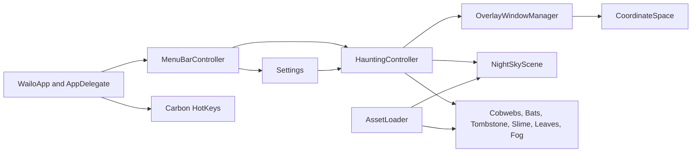

# Design: Haunting foundation

## Overview

This feature establishes the Swift package and the noninteractive visual substrate used by the ghost,
guidance, and safety features. AppKit owns windows and app lifecycle, SpriteKit owns sprite/particle
scenes, Core Animation owns cheap persistent fades/drifts, and SwiftUI is reserved for panels owned
by later features.



## Package and app lifecycle

`app/Package.swift` uses Swift tools 5.9, macOS 14+, an executable target named `Wailo`, processed
`Resources`, and a `WailoTests` test target. `WailoApp` installs an `AppDelegate`, then the delegate:

1. sets `.accessory` activation policy;
2. constructs `Settings`, overlays, menu, and hotkeys;
3. checks Accessibility trust and displays one explanatory prompt if absent;
4. starts haunting after screen construction;
5. schedules a recognized `WAILO_AUTODEMO` action using an injectable scheduler.

`MenuBarController` rebuilds state-dependent titles and checkmarks when its menu opens. Menu and
hotkey actions call narrow protocols (`HauntingActions`, `GhostActions`, `GuidanceActions`, and
`SafetyActions`) so foundation work can initially use no-op adapters without owning later features.

`HotKeys` uses Carbon `RegisterEventHotKey`. Registration failures are logged without task text or
personal context and shown through the Accessibility-status/debug surface.

## Settings and accessibility

`Settings` reads and writes only `wailo.*` keys and posts `Settings.changed` after an actual value
change. It exposes:

- stored values: Boo Level and all R12 toggles, including `showTargetFrames` consumed by guidance;
- derived values: sky/fog opacity, bat interval range, window limit, leaves/flicker/lightning flags;
- live `reduceMotion` from `NSWorkspace.accessibilityDisplayShouldReduceMotion`.

Consumers compare the previous applied snapshot with the new one. A settings update changes only the
affected component and never calls the full haunting start timeline.

Custom controls created by later features use a shared style for minimum type size, contrast, focus
ring, accessibility labels, and 44 pt hit targets. Reduce Motion is a shared semantic choice: every
movement effect also implements a fade/static alternative.

## CoordinateSpace

All conversion functions accept screen frames as input and have no AppKit dependency:

- `primaryHeight(screenFrames:)` requires the frame whose origin is zero;
- point and rect `axToCocoa` / `cocoaToAX`; rect conversion uses the source `maxY`;
- point and rect `globalToLocal` / `localToGlobal`;
- `screenIndex(containing:screenFrames:)`, then nearest rectangle by squared distance;
- validated `bbox1000ToCocoa` for `[xMin,yMin,xMax,yMax]`.

For backend bboxes, validation rejects non-finite values, values outside 0–1000, and reversed bounds.
Mapping follows the backend contract:

```text
x      = screen.minX + ((xMin + xMax) / 2000) * screen.width
cocoaY = screen.maxY - ((yMin + yMax) / 2000) * screen.height
```

The mapped rectangle uses scaled width/height and is intersected with the selected screen to absorb
floating-point edge error. No YOLO conversion is implemented because Wailo does not use the YOLO
backend routes.

Live wrappers obtain `NSScreen.screens` and identify the primary by `(0,0)`, never `NSScreen.main`.
If macOS temporarily reports no zero-origin frame during reconfiguration, the manager defers rebuild
to the next run-loop turn rather than guessing a primary.

## Windows and scenes

`ScreenOverlay` owns these per-display objects:

| Window | Level | View | Normal fps |
|---|---:|---|---:|
| ambience | desktop + 1 | `SKView` → `NightSkyScene` | 20 |
| decor | `.statusBar` | `SKView` → ambient `EffectsScene` | 30 |
| effects | screen saver | container for CA spotlight plus effects `SKView` | 30 |

Window creation follows every flag in R2.2. `EffectsScene` uses local Cocoa coordinates and named
layers `weather`, `decor`, `guide`, `cursorLayer`, and `fx`. `add(_:to:)` calls `wake()`.

Scene update checks recursively for active actions or emitters. It pauses only after an empty check
following the most recent wake. Components must stop and remove emitters after finite effects. An
active guide can raise only its selected effects view to 60 fps and restores 30 fps on cleanup.

`OverlayWindowManager` builds all screen sets, resolves an overlay by point, and observes
`NSApplication.didChangeScreenParametersNotification`. A rebuild captures the semantic state
(haunting on/off, settings, active feature callbacks), replaces windows, then asks components to
render their current state without replaying intro actions.

## HauntingController

`HauntingController` has `off`, `starting(generation)`, `on`, and `stopping(generation)` phases. Each
start/stop increments a generation so delayed callbacks cannot revive stale effects.

The start timeline begins at approximately 0.0, 0.25, 0.6, 1.2, 1.6, 1.9, 2.2, and 2.6 seconds for
dim/flicker, fog, sky, cobwebs, bats, tombstone, window decorations, and ghost appearance. Ordering
is tested with a fake scheduler; exact rendering duration is a manual check. Stop cancels ambient
timers, asks dependent features to stop, sinks the ghost, removes decoration, and runs
`sunriseAndFade` before ordering overlay windows out.

### Night sky

`NightSkyScene` renders gradient, static stars, hills, trees, and tombstones into one texture. Small
twinkling sprites, moon, and clouds remain separate. Persistent cloud drift uses Core Animation or
short scheduled actions so the SpriteKit view can sleep.

`moonProgress(date:)` uses a calendar and returns `nil` from 06:00 inclusive to 18:00 exclusive. It
returns 0 at 18:00, increases through midnight, and reaches 1 immediately before 06:00. The scene
repositions or hides the moon at least once per minute.

### Decorations

- `EdgeFog` creates four finite edge emitters, turns birth rates to zero after roll-in, removes them,
  and leaves one cheap vignette.
- `Cobwebs` draws six spokes and five sagging rings, flattens each corner web, and keeps top corners
  below the menu bar.
- `BatColony` installs three bats in Cozy and five otherwise while Bats is enabled. An injectable
  random source chooses 45–75 seconds between Cozy flights and 20–40 seconds otherwise; no
  `repeatForever` action keeps a scene awake, and disabling Bats removes nodes and timers.
- `DockLocator` searches the Dock AX tree for `AXTrashDockItem`, then localized names, then its last
  item. `TombstoneTrash` uses Dock orientation and the R3 fallback.
- `WindowTracker` samples eligible layer-zero windows at 10 Hz only while subscribed, filters out
  Wailo/desktop/tiny/transparent windows, keeps front-to-back order, and computes velocity.
- `SlimeDrips` maintains one group per selected window and one global active-drip token. A selected
  drip stretches, drops, and retracts. It applies the R3 speed thresholds and cooldown; disabling
  Slime removes its nodes and timers immediately.
- `FallingLeaves` starts only outside Cozy, reparents landed leaves to a capped per-window pile, and
  removes a pile when its window moves quickly or disappears.

Static art is flattened after installation. Timers schedule short actions and invalidate on stop or
generation change.

## Ambient cursor footprints

`CursorFootprints` polls only while haunting and enabled, and increases sampling frequency only while
movement is occurring. It accumulates path distance and emits at each spacing threshold, preserving
remainder between samples. `FootprintShape` draws a sole and four toes. Marks alternate side, rotate
with `atan2`, use the ambient lavender palette, and remove themselves after fading. Ghost hit testing
comes from the ghost feature through a protocol; without a pet, the excluded region is empty.

## Assets

`Sprite` associates each sprite with a resource name, emoji fallback, and accessibility description.
`AssetLoader` searches for `Wailo_Wailo.bundle` next to the executable and under
`Bundle.main.resourceURL`. It does not evaluate `Bundle.module`. Missing PNGs are replaced by emoji
rendered into an `NSImage`; required call sites never receive a blank image.

Noto Emoji source PNGs and their CC BY 4.0 attribution remain in `assets/ASSETS.md`. Procedural art
uses Wailo-owned paths, gradients, text, and particles.

## Privacy and vision boundary

`BackendEndpointPolicy` validates that every constructed request is relative to
`WAILO_BACKEND_URL`. Normal planning is owned by guidance, but foundation supplies request logging
that redacts bodies and allows only category, status, and bundle ID.

`VisionConsent` is false by default. The first enable action presents the exact pixel-sharing purpose
and destination before writing the setting. `VisionCaptureService` is unavailable until consent and
Screen Recording permission both exist. It captures only the target display, holds encoded bytes in
one request-scoped value, and releases them on completion/cancellation. It never writes bytes to a
file or log. The guidance feature decides when local search has failed and consumes the mapped result.

## Error handling

- Missing Accessibility permission produces reduced mode rather than app termination.
- Missing assets produce emoji fallbacks.
- A transient invalid screen layout defers overlay rebuild.
- Invalid vision bboxes or low confidence become “not found,” never coordinates.
- Every timer and delayed action is invalidated on stop or generation change.

## Verification

Property tests implement all properties in `requirements.md`. Manual checks cover window levels,
click-through behavior, all Spaces/full screen, display rebuild without transition replay, visual
ordering, reduced motion, permission denial, asset removal fallback, privacy request inspection, and
the R14 CPU protocol.
