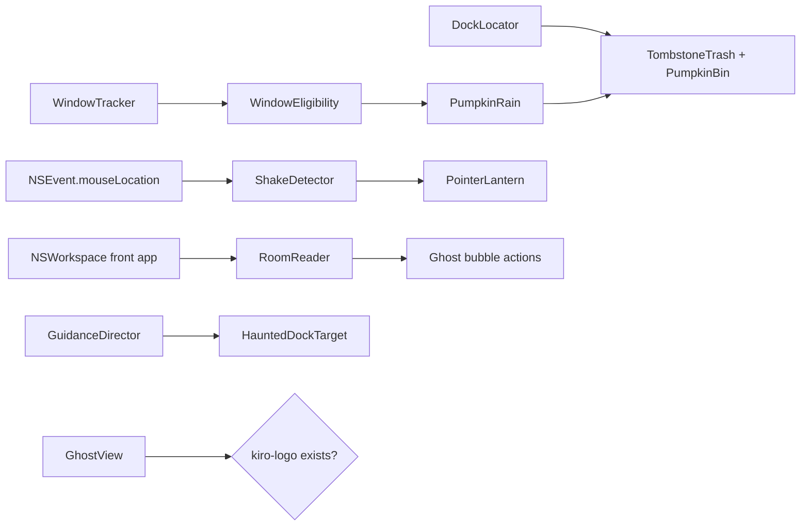

# Design: Haunting v2

## Overview

Haunting v2 replaces decorative leaves with interactive pumpkins and adds ambient intelligence without
changing Wailo’s backend or privacy boundary. Pure geometry and classifiers are isolated in
`HauntingV2Logic.swift`; SpriteKit renders noninteractive effects, while one tiny nonactivating panel
per pumpkin becomes mouse-active only during hover/drag.

## Pure logic

`HauntingV2Logic.swift` owns:

- `WindowEligibility.isFullScreen`, `isFlushWithMenuBar`, `titleBarLandingRegion`, and owner deny-list;
- `PumpkinPhysics.clampThrowVelocity`, point-to-rectangle distance, and bin magnet eligibility;
- `TombstonePlacement.frame` centered on Trash with bottom-Dock floor constraints;
- `ShakeDetector`, a timestamped horizontal reversal state machine with a post-trigger cooldown;
- `AppTipMapper`, which maps bundle/name pairs to a finite `AppTipKind`.

These functions have no SpriteKit or live AppKit state and receive rectangles, names, points, and
timestamps as values.

## Mascot

`GhostView` attempts a safe asset lookup for `kiro-logo.png` using `AssetLoader`. If present it uses a
single aspect-fit image layer. Otherwise its procedural body leans by a small fixed transform and is
white with a purple glow. The face contains only two tall oval eye layers. Existing semantic ghost
states map to six eye expressions:

- normal: idle/listening/searching/waiting;
- blink: scheduled idle blink;
- happy: found/success;
- surprised: planning/searchingHard;
- worried: wrongClick/danger/seance;
- sleeping: sleeping.

No mouth or blush layers are visible. Accessories such as lantern, crystal ball, warning, and candle
remain functional state indicators.

## Window tracking and pumpkins

`TrackedWindow` includes owner name. `WindowTracker` rejects configured system owners and Wailo before
publishing. `WindowEligibility` additionally rejects full-screen and menu-bar-flush frames. Both slime
and pumpkins call the same eligibility function.

`PumpkinRain` replaces `FallingLeaves`. It owns logical pumpkin bodies and schedules finite spawns.
Each pumpkin has position, velocity, state (`falling`, `landed(windowID,time)`, `dockIdle(time)`,
`dragging`, `magnetized`), and a small `PumpkinPanel`. The panel is borderless,
`.nonactivatingPanel`, transparent, and screen-saver/status-bar appropriate. A 30 Hz manager tick
positions panels and applies gravity. Panels set `ignoresMouseEvents = false` only while the pointer
is inside their visible pumpkin hit circle or a drag is active.

Landing uses the pure title-bar region and avoids the first 86 pt plus edge insets. Landed pumpkins
store a relative X coordinate so they follow window movement. They expire after 8 seconds unless
dragged. Window velocity above 500 pt/s detaches them with directional velocity.

Drag samples recent pointer positions. Release velocity is derived from the sample interval and
clamped by `PumpkinPhysics`. A direct bin hit buries immediately. Near misses within 90 pt enter a
short quadratic magnet path. Dock-floor pumpkins expire after 2 seconds.

## Tombstone bin

`TombstoneTrash` draws at the local center of the Trash rectangle. `TombstonePlacement` constrains its
frame while keeping a bottom-Dock bin below the Dock-top floor. The class exposes its global `binRect`
and burial count. `bury()` increments once per pumpkin ID and updates a small count label. The decor
window remains click-through.

## Atmosphere

`EdgeFog` becomes a finite intro effect. It creates no persistent vignette and removes its complete
root by three seconds. `NightSkyScene` removes cloud layers and timers. The scam warning may add a
separate cold mist owned and removed by `CursedPageWarning`; ordinary haunting never owns mist after
intro.

## Pointer lantern

`ShakeToFindController` polls the global mouse location without permission and feeds the pure
`ShakeDetector`. It is suppressed by an injected `isGuideActive` closure. On detection it adds a
lantern sprite, purple/orange glow rings, and the exact bubble text. The effect removes itself after
1.8 seconds and uses static fade under Reduce Motion.

## Room reader

`RoomReader` polls `NSWorkspace.frontmostApplication` once per second. It ignores Wailo and system UI,
tracks a stable bundle ID and dwell start, and stores last-offer times in memory. It calls
`AppTipMapper` after 6 seconds only when injected guide/warning predicates are false. The ghost bubble
uses large existing `SpeechBubble.Action` buttons. Accept actions reuse `GuidanceDirector`,
`CursedPageWarning`, or Live mode; Not now only dismisses. Cooldown is 15 minutes per bundle ID.

## Haunted Dock target

`HauntedDockTarget` uses AX Dock lookup to obtain the required app item frame. It renders into the
effects scene as a copy of the app icon, glow, and peeking procedural ghost; overlays remain
click-through. `GuidanceDirector` installs it for `.dockItem` steps and for steps whose bundle hint is
not yet frontmost. The search timeout is suspended while waiting for the hinted app. A 250 ms poll
removes the marker and restarts ordinary target search when the app becomes frontmost. Generation
cleanup removes markers and polls.

## Verification

XCTest covers every correctness property with generated tables/loops. After each numbered task,
`swift build` and `swift test` run from `app/`. Manual checks cover pumpkin hover capture without app
activation, dragging/throwing, traffic-light clearance, bin animation/count, tip buttons, and Dock
marker appearance.
