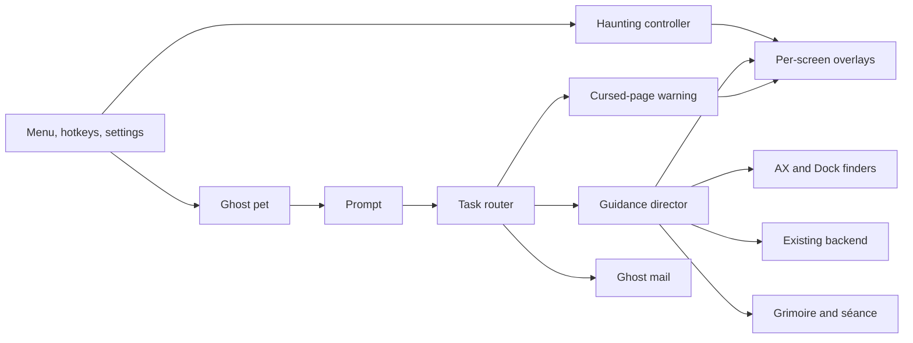

# Design overview: Wailo macOS app

## Feature boundaries

Wailo is one macOS accessory process built as the Swift package in `app/`. The specification is split
into three implementation boundaries:

- [Haunting foundation design](../haunting-foundation/design.md) owns process setup, settings,
  coordinates, per-screen overlay windows, ambience/decor scenes, assets, and privacy controls.
- [Ghost pet design](../ghost-pet/design.md) owns the ghost and bubble panels, pet state machine,
  prompt, and pure text router.
- [Guidance and safety design](../guidance-and-safety/design.md) owns target discovery, guide visuals,
  demos, backend planning, remembered targets, warnings, and mail.

## Shared runtime contracts

### Foundation API used by other features

- `OverlayWindowManager` provides an overlay for a global Cocoa point, primary-display fallback, and
  screen-change callbacks.
- `CoordinateSpace` owns every AX, Cocoa, local-scene, and vision-bbox conversion.
- `Settings` publishes `Settings.changed` and exposes Boo Level, Reduce Motion, and privacy toggles.
- `EffectsScene.add` wakes a paused scene; clients remove their nodes when an effect ends.
- `AssetLoader` returns a bundled PNG or a rendered emoji and never terminates for a missing bundle.

### Ghost API used by other features

- `GhostPet` accepts semantic state-machine events, exposes hit testing, and owns bubble placement.
- `SpeechBubble` provides passive messages, warning/actions, and a nonactivating text prompt.
- `TaskRouter.route(_:)` is pure and returns exactly one route for every string.

### Guidance API used by shell and router

- `GuidanceDirector.run`, `next`, and `stop` own one guide generation at a time.
- `LiveMode.run(task:)` is the only route from submitted free text to `POST /plan`.
- `CursedPageWarning`, `SeanceMode`, `GrimoireWindow`, and `GhostMail` expose start/show/dismiss
  entry points to the menu and hotkeys.

## Dependency and privacy boundaries

`URLSession.shared` is the only networking mechanism. Requests go only to `WAILO_BACKEND_URL`. A
normal plan sends the user-submitted task and `platform: "macos"`; it does not send screenshots,
raw AX text, email, or general screen context. The optional vision path is separately enabled and
consented, sends one current-screen screenshot only to `/nova-vision`, and never writes or logs the
pixels.

The backend implementation is not part of this design and must not be rewritten.

## Verification

[R14](requirements.md#r14-global-quality-gates) applies to all feature plans. Pure properties are
specified in each feature’s “Correctness properties” section. Manual visual, permission, display,
and CPU checks complement those automated properties.
