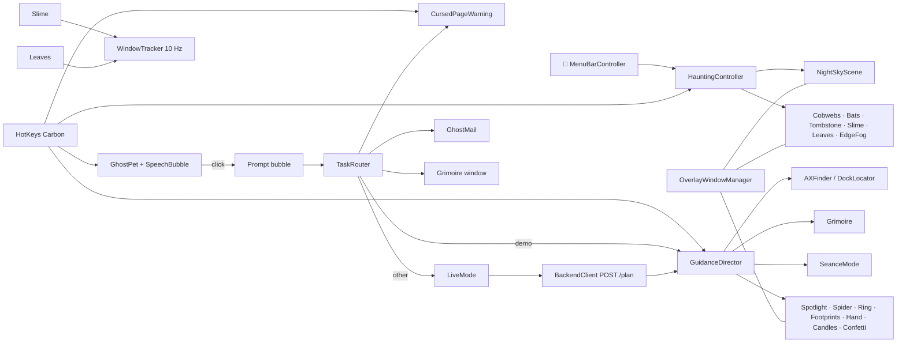

# Design: Wailo macOS app

## Overview
Wailo is a single-process accessory app (a Swift Package in `app/`). Singletons coordinate a set of
small visual components that render into per-screen overlay windows. The only network dependency is
the existing Waylo backend (`POST /plan`), and it is optional.

## Windows and scenes (per screen) — `OverlayWindowManager`
`ScreenOverlay` holds:
- `ambienceWindow` (desktop + 1) → `SKView` (20 fps) → `NightSkyScene`
- `decorWindow` (.statusBar) → `SKView` (30 fps) → `EffectsScene` called **`ambient`**
- `effectsWindow` (screenSaver) → a container `NSView` holding:
  - `FogSpotlightView` (CAShapeLayers, bottom)
  - `SKView` (30 fps, 60 while guiding) → `EffectsScene` called **`effects`** (top)

`EffectsScene` details:
- `anchorPoint = .zero`, size = screen size, and **local Cocoa coordinates**
- layers by zPosition: `weather`, `decor`, `guide`, `cursorLayer`, `fx`
- `local(_ global:)`, `localRect(_:)`, `visibleFrameLocal`, `menuBarHeight`
- `add(_:to:)` adds a node and wakes the view; `wake()` resumes rendering
- `update` pauses the view when no node `hasActions()` and there is no `SKEmitterNode`, with a grace
  period of one check after each wake

`OverlayWindowManager.shared`:
- `setUp()` builds overlays for `NSScreen.screens` and observes screen changes, calling
  `onScreensChanged` callbacks
- `overlay(containing: globalCocoaPoint)` uses `CoordinateSpace.screenIndex`
- `primary`, `show()`, `hide()`

## CoordinateSpace (pure + live wrappers)
- Pure, unit-tested:
  - `primaryHeight(screenFrames:)`
  - `axToCocoa` / `cocoaToAX` and the rect versions (`y' = h − maxY`)
  - `globalToLocal` / `localToGlobal`
  - `screenIndex(containing:screenFrames:)`, falling back to the nearest screen
  - `visionRectToAX` (flip), `yoloRectToAX` (no flip), `bbox1000ToCocoa`
- Live wrappers use `NSScreen.screens`. `CGRect.center` extension.

## Haunting — `HauntingController`
- `start()` timeline, in seconds:

  | Time | Step |
  |---|---|
  | 0 | flicker/dim (`fx` black sprite) |
  | 0.25 | `EdgeFog.rollIn(ambient, peak 0.6, settle by Boo level)` |
  | 0.6 | `sky.fadeIn(1.4)` |
  | 1.2 | `Cobwebs.install` |
  | 1.6 | `BatColony.install` |
  | 1.9 | `TombstoneTrash.install` |
  | 2.2 | `WindowTracker.subscribe`, `SlimeDrips.start`, `FallingLeaves.start` |
  | 2.6 | `GhostPet.appear(risingFrom: tombstoneTop)`, `CursorFootprints.start`, `CursedPageWarning.startWatching`, lightning timer |

- `stop()` stops guidance, séance and warning, sinks the ghost, removes decor (animated), plays
  `sky.sunriseAndFade(2.2)`, then hides the windows.
- `applySettings()` reacts to `Settings.changed` by diffing the last-applied settings.
- `NightSkyScene`:
  - all static art goes into one node, flattened with `view.texture(from:crop:)` into one sprite
  - on top: about 14 twinkling sprite stars, the moon (glow, disc, craters) repositioned every 60 s
    with `moonProgress(hour:)` (pure), and 5 soft-sprite clouds drifting with time-based custom
    actions
  - sunrise gradient overlay and a lightning flash sprite
- `Cobwebs`: procedural (6 spokes, 5 sagging rings over a 90° quadrant), flattened to a texture,
  rotated per corner, top corners below the menu bar, growing from scale 0.01.
- `BatColony`: 3 bats (5 outside Cozy) rotated π (hanging) under the menu bar, static. A timer picks
  one to fly a bezier loop with wing flaps (`scaleX`) and come back.
- `TombstoneTrash`: `DockLocator.trashFrame()` matches subrole `AXTrashDockItem`, then localized
  names, then the last item. Placement depends on Dock orientation, with a bottom-right fallback.
  Procedural stone, "R.I.P." label (Georgia-Bold), grass and a small pumpkin. Exposes `globalTop`.
- `SlimeDrips`:
  - subscribes to `WindowTracker`
  - takes front windows whose top edge is visible (`isTopEdgeVisible`), limited per Boo level
  - per window: a wavy rim plus teardrop drips, on a group node that follows the window's top-left
    with a 0.1 s move
  - splatters when speed > 900 pt/s, with a 1 s cooldown; waits for speed < 150 before regrowing
  - a timer animates one drip at a time (stretch → drop → retract)
- `FallingLeaves`: a timer spawns a leaf. It lands on the highest visible window top under its x, or
  fades at the bottom. Landed leaves are reparented into a per-window pile (max 14). The pile slides
  off when speed > 500 or the window disappears.

## Ghost — `GhostPet`, `GhostView`, `GhostStateMachine`, `SpeechBubble`
- `GhostPanel`: 220×220 `NSPanel`, non-activating. Set `isFloatingPanel` **before** level
  (screenSaver + 1). Not key.
- Modes: `hidden | parked | anchored(point) | dragging`. **There is no follow mode.**
  - `anchored` is only for the rise/sink animation: spring `v = v·0.8 + Δ·0.1`. It becomes `parked`
    on arrival.
  - Drag: `mouseDown` stores the offset; the tick sets position = mouse + offset. `mouseUp` with
    movement < 4 pt opens the prompt. Otherwise it clamps to `visibleFrame` and saves
    `wailo.ghostX/Y`.
- The tick (60 Hz, could be lowered when parked):
  - idle → sleep after 600 s (or 60 s between 0–5 am); mouse movement wakes it
  - yawn every 40 s or more when idle
  - toggle `ignoresMouseEvents` by `bodyRect.contains(mouse)`
  - hover giggle
  - keep the bubble attached
- `GhostView`: `GhostBodyView` (procedural `draw`) with parameters `eyeOpen`, `mouth (smile, o,
  yawn, frown, giggle, sleepy)`, `puff`, `frost`, `glow`, `glowRadius`, `tint`. It also has
  `CauldronView`, one accessory `NSImageView`, and CA effects (wisps, cauldron bubbles, rising
  candles). The anchor point is centred in `layout()`. Animations: bob (additive translation.y),
  wiggle, shakeHead, swing, pulse, nudge, floatUp.
- `GhostStateMachine` (pure):
  - `handle(event) -> state`
  - `danger` saves the previous state and `dangerCleared` restores it
  - `cancel` → idle
  - transition table:
    - `startPlanning`: idle/listening/sleeping/success → planning
    - `startSearching` → searching
    - `escalateSearch`: searching → searchingHard
    - `targetFound` → found
    - `awaitClick`: found/wrongClick → waitingForClick
    - `clickedWrong`: waitingForClick → wrongClick
    - `wrongClickRecovered`: wrongClick → waitingForClick
    - `cannotFind`: searching/searchingHard → seance
    - `stepDone(last)`: waitingForClick/found/seance → success if last, else searching
    - `idleTooLong`: idle → sleeping
    - `activity`: sleeping/success → idle
- `SpeechBubble` (BubblePanel, screenSaver + 2, `canBecomeKey`):
  - `say(text, style: normal|warning|seance, buttons:, autoHide:, centerOnScreen:)`
  - `ask(prompt:placeholder:onSubmit:)` uses SwiftUI `PromptContent` with `@FocusState`,
    `onSubmit` and `onExitCommand`, then `makeKeyAndOrderFront`
  - `follow(ghostFrame:)` positions above the ghost, or below it when there's no room, clamped
  - **measure `fittingSize`, then `sizingOptions = []`**

## Guidance — `GuidanceDirector`
- State: `script`, `index`, `generation` (bumped on stop to cancel stale async work), `targetCocoa`,
  current visual objects, click timer, footprint timer, global keyDown monitor (Return).
- `run(script)`:
  - start haunting if needed
  - `stop()` the previous run
  - ghost `startPlanning`, bubble "Let me brew a plan…", `bubbleUpCandles(n)`, `CandleProgress`
  - after 1.8 s → `beginStep()`
- `beginStep()`:
  - clear the visuals; `candles.setCurrent(i)`; ghost `startSearching`
  - an instruction-only step goes to found → awaitClick and waits for Return or Next
  - otherwise `search()`
- `search()` loop (0.8 s first, then 0.25 s): spell match → `Grimoire.locate`, then AX
  `find(query, bundleHint)`, escalating at 1.6 s and going to the séance at 3.6 s.
- `present(axRect)`:
  - convert to Cocoa and pick the overlay containing it
  - set 60 fps
  - `spotlight.show`
  - `SpiderPointer` if index 0, else `PumpkinRing`
  - `GhostHand`, `FootprintTrail` (walk now and every 2.8 s), debug frame
  - bubble with the instruction, `awaitClick` after 0.5 s, start click polling
- Click polling (60 Hz):
  - detect the rising edge of `NSEvent.pressedMouseButtons & 1`
  - ignore clicks where `ghost.covers(p)`
  - inside `target.insetBy(-10)` → `stepComplete`; otherwise → `wrongClick`
- `stepComplete` → next step, or `finish` (confetti, "You did it!", reset after 3.5 s).
- `TargetQuery`: `none | dockItem | menuBarItem | menuItem | element(keywords, roles) |
  safariAddressBar | smart(label)`. `AdvanceRule`: `clickInTarget | returnKeyOrNext`.
  `HandAction`: `tap | doubleTap | drag(to:) | none`.

## Visual components (each `init(scene:…)` + `remove()`)
- `FogSpotlightView`:
  - 3 `CAShapeLayer`s (even-odd: screen rect + circle)
  - hole radii `base + i·16`, with `base = max(w,h)/2 + 26`
  - per-layer opacity `1 − (1−dim)^(1/3)`; path animation from radius 1
- `SpiderPointer`:
  - a pivot at the screen top above the target, with a thread path and a spider sprite
  - drop by custom action (1 s, ease-out cubic plus a tiny bounce)
  - swing angle `asin(4/len)`
  - Reduce Motion: fade in
- `PumpkinRing`: rounded rect inset −9, orange stroke 4, glow 6, pulsing scale; bobbing 🎃 at the
  top-right.
- `FootprintPath.marks(from:to:spacing:sideOffset:) -> [FootprintMark]` (pure):
  - quadratic curve with the control point offset perpendicular by 20% of the distance
  - arc-length sampling, alternating side offsets
  - **the last mark is exactly the target centre**
- `FootprintTrail` animates the marks (orange, glowing) one by one.
- `FootprintShape.make(isLeft:color:scale:glow:)`: a sole ellipse plus 4 toes.
- `GhostHand`: 👆 sprite (anchor 0.42, 0.95) at 0.7 alpha; action loops.
- `CandleProgress`:
  - a pill bar at `visibleFrame.midX`, `minY + 52`
  - wax, wick and flame (teardrop path with glow)
  - `setCurrent(i)` flickers with a `scaleY` sequence; `lightAll()` does a "whoomp"
- `Confetti.burst(at:)`: 36 sprites (candy, bat, pumpkin, lollipop, sparkles) rise then fall with
  spin and fade.

## Services
- `AX` helpers:
  - `attr`, `element` (with a CFTypeID check), `children`, `role`, `subrole`, `title`, `desc`,
    `identifier`, `placeholder`
  - `frame` (kAXPosition/kAXSize AXValues)
  - `isOnScreen`, `normalize` (lowercase, strip "…")
- `AXFinder`:
  - `appElement(bundleHint)` returns nil until the hinted app is frontmost, so the caller retries
  - `menuBarItem`, `menuItem` (searches AXMenuBarItem → AXMenu → AXMenuItem up to depth 5, on-screen
    frames only, i.e. open menus)
  - `element(in:keywords:roles:)`: BFS over windows (≤ 4000 nodes); exact match beats contains;
    smaller wins
  - `smart(label)`
  - `safariURL()` (AXWebArea `AXURL`)
- `DockLocator`: the Dock process → AXList → AXDockItem (title, subrole, frame).
- `WindowTracker`:
  - `CGWindowListCopyWindowInfo([.optionOnScreenOnly, .excludeDesktopElements])`, layer 0, not our
    PID, ≥ 120×80, alpha > 0.1
  - front-to-back order; per-window velocity
  - subscriber-driven 10 Hz timer (common run-loop mode)
  - `isTopEdgeVisible` (pure)
- `BackendClient`:
  - base URL from `WAILO_BACKEND_URL`, default `http://localhost:3000`
  - `plan(task:)` and `parse(data:)` (pure: strip fences, read `clarify`, read steps)
  - `Failure: noBaseURL | http(code, details) | badResponse | clarify(prompt)`

## Data models
- `GuideStep { instruction, query: TargetQuery, action: HandAction, bundleHint: String?, advance:
  AdvanceRule }`
- `DemoScript { title, steps }`
- `Spell: Codable { id, bundleID, appName, stepText, relX?, relY?, absX, absY, createdAt, timesCast
  }`
- `Grimoire: ObservableObject`
  - `@Published spells`
  - JSON at `~/Library/Application Support/Wailo/grimoire.json` (ISO 8601 dates, pretty-printed)
  - `learn`, `forget`, `markCast`, `match(bundleID:stepText:)`, `locate(spell) -> AX rect 44×44`,
    `static matches(a,b)` (equal word sets, or Jaccard ≥ 0.8)
- `TaskRouter.Route: newFolder | safari | cursed | ghostMail | grimoire | live(String) | nothing`
  (pure `route(_:)`)
- `Settings`:
  - `booLevel`, `footprints`, `slime`, `bats`, `sounds`, `watchSafari`, `visionFallback` (false),
    `showTargetFrames`
  - derived: `fogDim`, `skyOpacity`, `ambientFog`, `batFlightInterval`, `leavesEnabled`,
    `flickerEnabled`, `lightningEnabled`
  - `reduceMotion` from `NSWorkspace`
- `Palette`: pumpkin, lavender, slime, slimeDark, nightTop/Bottom, fog, candleFlame, frost,
  bubbleText, bubbleBG.

## Safety — `CursedPageWarning`
- `isCursed(url:)` (pure keyword check).
- Watch timer: 2 s, only while Safari is frontmost, once per URL.
- `trigger()`: frost node per overlay (cool tint at 0.16, 4 edge gradient sprites scaling in, crystal
  paths), ghost `dangerDetected`, centred warning bubble with buttons.
- `dismiss()`: melt (fade), `dangerCleared`, "Phew!".
- Close tab: `NSAppleScript` "close current tab of front window".

## Séance — `SeanceMode`
- A 60 Hz timer moves the planchette node (procedural board with the lens at the origin) to the
  cursor in the right overlay.
- The rising-edge click (not on the ghost or bubble) calls `record`: window under the point → bundle
  and relative position → `Grimoire.learn`, glow, completion.
- `beginManual()` for the menu.

## Error handling
- AX unavailable → empty results → séance (the UI still works).
- Backend failure → friendly bubble, then the demo.
- Missing PNG → emoji render. Missing resource bundle → nil (never `Bundle.module`).
- Every async callback in the director checks `generation`.

## Testing strategy
- XCTest for the pure types listed in requirement R14.2.
- A manual checklist per feature (see `tasks.md`).
- `WAILO_AUTODEMO` for repeatable runs, screenshotted with `screencapture`.
- A CPU check with `ps -o %cpu` after 20 s idle.
